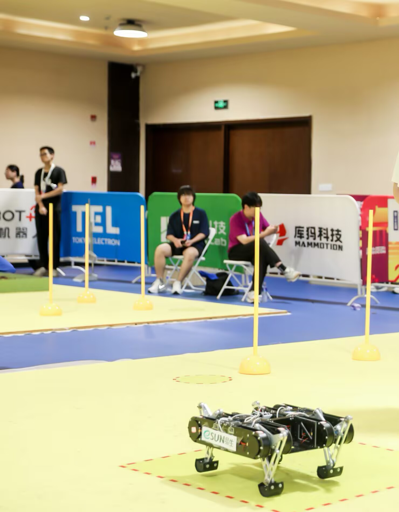

# ROBOCON2026\-8006DOG

> 苏州工学院 2026赛季足式机器人（二队）项目开源
> 
> 

## 简介

本仓库是**苏州工学院 ROBOCON 2025 足式机器人二队**的软件、控制方案与配套资料归档整理。

2026赛季成绩：**两项项目均获得全国三等奖（国三）**

主体代码框架沿用上赛季二队：https://github.com/Childhood-zml/ROBOCON2025-8009DOG
迭代部分：

- **硬件重标定**：上赛季编码器换算系数 1100\.26（减速比 3591/187），26 赛季换了电机减速比后改成 515\.66，对应不同关节零位与安装方向

- **新增 MIT 双环接口**：上赛季只有 `dm_j8009_pos_ctrl()` 单环位置控制，26 赛季新增 `dm_j8009_all_dual_ctrl()`——位置环输出作速度目标、速度环输出作力矩，并为 8 个关节单独挂了 `PID_Speed[8]`，`dm_j8009_ctrl.c` 。

- **补齐热保护 \+ 修 bug \+ 精简架构**：上赛季在 `detect_task.c` 把电机温度巡检**整段注释掉了**（只剩 LED 空壳），26 赛季恢复并加了回滞：`T_Rotor ≥100°C` 失能、`<80°C` 恢复；修了 `PID_Reset()` 积分项没清零的 bug；同时把旧状态机重构，去掉 `LegGain`、`DetachedParam`、`Cycloid_Generator_t` 等冗余抽象，Task 层逻辑直写，便于调试。

## 演示

图片直播：

- [https://alltuu\.cc/album/73a32108739142c368e1fa39230fa9c4/?menu=live](https://m/)

## 仓库目录结构
| 目录 | 说明 |
| --- | --- |
| `1.Software/` | 完全下位机(STM32F427，Keil uVision 工程：robohorse2022.uvprojx)|
| `2.Document/` | 资料与手册（PDF） |
| `3.Picture/` | 比赛图片 |
| `assets/` | README 图片素材 |

## 快速开始

### 下位机 Keil 工程

打开 [`1.Software/project_8006_2026/robohorse2022/MDK-ARM/robohorse2022.uvprojx`](https://github.com/Childhood-zml/ROBOCON2026-8006DOG/blob/main/1.Software/project_8006_2026/robohorse2022/MDK-ARM/robohorse2022.uvprojx)

> 环境建议：Keil uVision5，适配 STM32F427 芯片，配套 DM 8006 电机驱动
> 
> 

## 重要声明

由于本人2026赛季电控方向成员，部分原始设计文档、调试日志、内部说明存在缺失，资料排布也可能不够规整，敬请谅解。 如果有疑问，欢迎在 Issue 中交流讨论。

## 致谢 \& 参考开源

项目方案参考（在此特别感谢宁波工程学院的开源）：

- [https://gitee\.com/Ha\-WthorN/robocon\-nbut](https://gitee.com/Ha-WthorN/robocon-nbut)

- [https://gitlab\.com/nbutroboticslab/Competition\_Projects/robocon/robocon2022](https://gitlab.com/nbutroboticslab/Competition_Projects/robocon/robocon2022)

仓库文档框架参考：

- [https://blog\.csdn\.net/weixin\_52612260/article/details/134124028](https://blog.csdn.net/weixin_52612260/article/details/134124028)

- [https://blog\.csdn\.net/Hbutneymar/article/details/147161479](https://blog.csdn.net/Hbutneymar/article/details/147161479)

资料参考：

- [【必读】LocoWiki介绍](https://lain-database.feishu.cn/wiki/HwyJwB70niKbW7khmwlcbCH2nXb)

## 许可声明

本仓库当前未附带 `LICENSE` 文件；如需在论文/商业项目中使用，请先联系作者确认授权范围。

